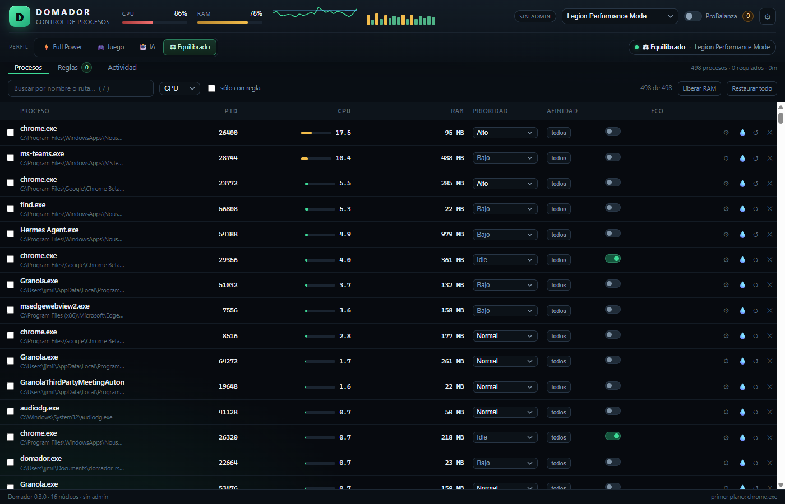

# Domador

Control de procesos y rendimiento para Windows, escrito en Rust. Una alternativa open source a Process Lasso, enfocada en una sola cosa: que la notebook rinda al mango cuando la necesitás — jugando o corriendo herramientas de IA — sin telemetría, sin cuentas y sin instalar medio sistema.

Un solo `.exe`. Sin dependencias en tiempo de ejecución. Sin llamadas a casa.

**Descargar:** [Domador v0.4.0](https://github.com/jjmilano/domador/releases/tag/v0.4.0) · Windows 10/11 x64.



## Por qué

Windows reparte CPU como puede: el antivirus escanea mientras jugás, el indexador aparece en el peor momento, el navegador con cuarenta pestañas se come un núcleo entero, y el plan de energía sigue en "Equilibrado" cuando estás por arrancar una partida. Process Lasso resuelve parte de eso, pero es cerrado, pesado y te pide confiar en lo que hace por atrás.

Domador hace lo mismo (y algunas cosas más) con el código a la vista: reglas por ejecutable, ProBalance con cooldown, perfiles de energía, SmartTrim y una API local para que lo maneje un agente de IA. El caso típico es una notebook de 8 núcleos híbridos y 16 GB donde el juego, el modelo local y el navegador se pelean por los mismos hilos.

## Estado

v0.4, usable y probado en Windows 11. El motor Rust, la UI web, la API HTTP y el servidor MCP están conectados. `cargo test` cubre prioridad, afinidad, EcoQoS, trim, restauración, reglas persistentes, autenticación de la API y handshake MCP (4/4). El binario release pesa **2,0 MB**, no necesita runtime ni servicio, y el plan de energía se restaura al salir.

Lo que falta está en el roadmap: icono de bandeja, servicio elevado para procesos protegidos y CPU sets. Nada de eso impide usarlo hoy.

## Características

### ProBalance con cooldown

El corazón del proyecto. Cada tanto mira el consumo de CPU por proceso y, cuando uno se pasa de rosca, lo baja de prioridad en lugar de matarlo.

- Umbral configurable (`threshold`), tiempo que tiene que sostenerlo (`sustain_s`) y umbral de restauración (`restore_below`) con su propia espera (`restore_s`).
- **Vía rápida** (`fast_threshold`, `fast_sustain_s`): si un proceso se come 25% o más de la máquina durante 2 s, se regula sin esperar los 9 s. Los picos moderados siguen la vía lenta para no flapear; el cooldown se aplica igual.
- Baja a `below_normal` o `idle`, a elección, y opcionalmente activa EcoQoS mientras está regulado.
- **Cooldown** (`cooldown_s`): después de restaurar un proceso no lo vuelve a tocar por un rato. Evita el ping-pong de prioridades que castiga el rendimiento más de lo que ayuda.
- **Protección de apps interactivas**: `skip_foreground` no toca la ventana en primer plano y `skip_interactive` saltea cualquier proceso con ventana visible (navegador, chat, IDE). La lista `protect` es manual y tiene la última palabra.
- Todo lo que toca queda registrado y se puede restaurar a mano.

### Reglas por ejecutable

Una regla matchea por ruta completa (`C:\Juegos\juego.exe`), por nombre (`chrome.exe`) o con comodines (`*steam*`), y se aplica al iniciar cada proceso y cuando la creás.

| Campo | Qué hace |
|---|---|
| `priority` | `idle`, `below_normal`, `normal`, `above_normal`, `high`, `realtime` |
| `affinity` | Máscara de núcleos, ej. `0-3,8`. Vacío = no cambiar |
| `eco` | Activa o desactiva EcoQoS (Efficiency Mode) |
| `io` | Prioridad de E/S: `very_low`, `low`, `normal`, `high` |
| `mem` | Prioridad de memoria: `very_low` … `normal` |
| `watchdog` | `keep_alive` (relanzar) y `max_instances` (limitar instancias) |

Las reglas se guardan en un JSON local y sobreviven al reinicio.

### Watchdog

- `keep_alive`: si el proceso se cierra, lo relanza. Necesita ruta completa, no alcanza con el nombre.
- `max_instances`: si hay más instancias que el límite, cierra las sobrantes (las más nuevas primero).

### SmartTrim

Libera el working set de los procesos cuando la RAM del sistema pasa un umbral, cada N segundos y salteando los procesos chicos (`min_mb`). Es la versión con criterio del "liberador de RAM": no toca lo que estás usando y no corre en loop.

### Planes de energía y perfiles

Domador lista los planes de energía del sistema, permite cambiarlos y puede hacerlo solo: un proceso disparador (`trigger`, ej. `juego.exe`) hace que pase al plan de juego mientras está abierto y vuelva al plan base al cerrarse. Al salir de Domador se restaura el plan original.

Perfiles listos para usar, cada uno con su combinación de plan de energía, ProBalance y reglas:

| Perfil | Para qué |
|---|---|
| **Full Power** | Todo al máximo, sin límites. Sólo con la notebook enchufada |
| **Juego** | Prioridad al juego, ProBalance agresivo con el fondo, plan de alto rendimiento |
| **IA** | Modelos locales: hilos y memoria para el runtime, EcoQoS para el resto |
| **Equilibrado** | Uso normal, ProBalance suave, plan del sistema |

### API HTTP local, servidor MCP y UI web

- `domador serve` levanta un servidor HTTP en `127.0.0.1` (puerto 8787 por defecto, `--port` para cambiarlo) que sirve la UI web y la API JSON.
- `domador mcp` expone las mismas operaciones como servidor MCP por stdio, así un agente (Claude, Codex, Hermes) puede leer el estado, aplicar reglas y cambiar de perfil con herramientas normales.
- La UI es HTML/JS plano sin build: tabla de procesos, reglas, actividad del motor, ajustes y medidores por núcleo.

## Seguridad

Leé esto antes de apretar Full Power.

- **Full Power requiere estar enchufado.** Con batería se rechaza: el perfil desactiva límites de energía y te la come en minutos.
- **Calienta y consume.** Es esperable. Si la notebook throttlea, el perfil no hace magia: sólo deja de frenar.
- **El plan de energía original se restaura al salir**, también con Ctrl+C. Si el proceso muere de golpe (crash, Task Manager), el plan queda como estaba en ese momento.
- **No requiere admin para lo básico**: prioridades, afinidad y EcoQoS sobre procesos propios funcionan sin elevar. Procesos del sistema y algunos servicios van a rechazar los cambios; la UI muestra `sin admin` cuando corre sin privilegios.
- **Sí requiere admin** para: prioridades sobre procesos de otros usuarios, `realtime`, y varias operaciones de plan de energía en máquinas con políticas de grupo.
- **La API escucha sólo en loopback** y no tiene autenticación. Cualquier proceso local puede llamarla: no la expongas a la red.
- **Sin telemetría.** No hay analytics, ni crash reporting, ni update check. El binario no abre conexiones salientes.

## Instalación

Requisitos: Windows 10 u 11 (x64), Rust stable (1.75 o posterior).

```bash
git clone https://github.com/<usuario>/domador.git
cd domador
cargo build --release
```

El binario queda en `target/release/domador.exe`. Copialo donde quieras y agregá esa carpeta al `PATH` si te da fiesta escribir la ruta.

## Uso

```bash
domador              # arranca el motor y abre la UI en el navegador
domador serve        # sólo el servidor (UI + API), sin abrir nada
domador serve --port 9000
domador mcp          # servidor MCP por stdio (lo lanza el cliente, no vos)
domador --version    # versión del binario
```

Sin argumentos arranca el motor, levanta la API en segundo plano y abre `http://127.0.0.1:8787`.

## Integración con IA

El servidor MCP habla JSON-RPC por stdio y expone herramientas para leer el estado, listar procesos, aplicar prioridad/afinidad/EcoQoS, administrar reglas y cambiar de perfil.

**Claude Desktop** (`%APPDATA%\Claude\claude_desktop_config.json`):

```json
{
  "mcpServers": {
    "domador": {
      "command": "C:\\Tools\\domador\\domador.exe",
      "args": ["mcp"]
    }
  }
}
```

**Codex** (`~/.codex/config.toml`):

```toml
[mcp_servers.domador]
command = "C:\\Tools\\domador\\domador.exe"
args = ["mcp"]
```

**Hermes** (`~/.hermes/config.yaml`):

```yaml
mcp_servers:
  domador:
    command: "C:\\Tools\\domador\\domador.exe"
    args: ["mcp"]
```

Reiniciá el cliente después de agregarlo. Las herramientas se llaman `domador_status`, `domador_processes`, `domador_set_priority`, `domador_set_affinity`, `domador_set_eco`, `domador_profile`, `domador_add_rule`, `domador_restore`, `domador_power_plans` y `domador_log`.

El servidor MCP habla con la API en el puerto 8787 por defecto. Si levantás `serve --port 9000`, pasale el mismo a `mcp --port 9000` o definí `DOMADOR_PORT=9000` en el entorno del cliente.

### Endpoints HTTP

Todos son `POST` con body JSON salvo los `GET`. Respuesta: `{"ok": true}` o `{"ok": false, "error": "..."}`.

| Endpoint | Body | Qué hace |
|---|---|---|
| `GET /api/state` | — | Snapshot completo: sistema, procesos, reglas, settings, contadores |
| `POST /api/meta` | `{"pid":1234}` | Detalle de un proceso (ruta, usuario, hilos, handles) |
| `POST /api/profile` | `{"name":"gaming"}` | Cambia de perfil: `full_power`, `gaming`, `ai`, `balanced` |
| `POST /api/priority` | `{"pid":1234,"cls":"high"}` | Cambia la prioridad |
| `POST /api/affinity` | `{"pid":1234,"cpus":[0,1,2,3]}` | Fija afinidad de CPU |
| `POST /api/eco` | `{"pid":1234,"enabled":true}` | Activa/desactiva EcoQoS |
| `POST /api/plan` | `{"guid":"..."}` | Cambia el plan de energía |
| `POST /api/trim` | `{"pid":1234}` | Libera el working set |
| `POST /api/restore` | `{"pid":1234}` | Restaura los valores originales |
| `POST /api/kill` | `{"pid":1234}` | Termina el proceso |
| `POST /api/rules` | `{"op":"create","rule":{...}}` | `create`, `update`, `delete`, `toggle`, `apply` |
| `POST /api/probalance` | `{"enabled":true,...}` | Ajusta ProBalance en caliente |

```bash
curl -s http://127.0.0.1:8787/api/state | jq '.counts'
curl -s -X POST -H "X-Domador: 1" -H "Content-Type: application/json" \
  -d '{"name":"gaming","target":"juego.exe"}' http://127.0.0.1:8787/api/profile
curl -s -X POST -H "X-Domador: 1" -H "Content-Type: application/json" \
  -d '{"pid":4321,"cls":"high"}' http://127.0.0.1:8787/api/priority
```

## Benchmark

Medición real en esta notebook (Legion, 16 hilos lógicos, Windows 11), misma sesión y misma carga para los dos. Carga: 2 procesos `domador-hog` de 2 hilos con fases 12 s activo / 6 s idle / 12 s activo. Lasso corre con su configuración actual (umbral 5% por proceso / 10% total, 9 s); Domador se configuró con umbral 5%, 9 s de sustain y 30 s de cooldown.

| Métrica | Process Lasso | Domador Rust |
|---|---|---|
| RAM del motor | 20,0 MB | 17,3 MB |
| CPU del motor (idle) | 0,19% | 0,12% |
| Cambios de prioridad en 42 s (2 hogs) | 8 (4 por proceso: 2 bajadas + 2 restauraciones) | 4 (2 por proceso: 1 bajada + 1 restauración) |
| Primer throttle | 0,1 s | 8,8 s |
| Latencia de acciones p50 / p95 | sin API ni CLI documentada | 2,37 / 25,42 ms |
| Distribución | instalador + servicio | un `.exe` de 2,02 MB |
| Churn real (30 min de su log) | 35 bajadas sobre 5 procesos, incluidos Chrome, WebView y Hermes | — |

**Lectura honesta:** Lasso gana en reacción inicial; Domador gana en huella (17,3 MB y 0,12% contra 20 MB y 0,19%), en estabilidad (la mitad de cambios de prioridad), en tamaño de distribución, en automatización (API/MCP) y en no necesitar servicio. La UI de Domador es una pestaña del Edge que ya está abierto, así que su costo no es comparable con una GUI nativa; el motor es el número que importa cuando jugás.

La vía rápida de ProBalance, medida aparte con un hog de 4 hilos (25% de la máquina), baja la prioridad en **1,8 s** sin esperar los 9 s. Los picos moderados siguen la vía lenta para no flapear.

No hay FPS medidos todavía. El próximo benchmark serio es con CapFrameX: mismo juego, misma escena, con y sin perfil Juego.

Reproducible con `python bench/bench.py` (usa `bench/domador-hog.exe` y `bench/lasso-results.json`, los resultados crudos quedan en `bench/results-rs.json`).

## Arquitectura

```
src/
├── main.rs     CLI: domador, domador serve, domador mcp
├── win.rs      Wrapper crudo de Win32 (OpenProcess, SetPriorityClass, SetProcessAffinityMask,
│               SetProcessInformation/EcoQoS, EmptyWorkingSet, ventanas visibles, planes de energía)
├── sys.rs      Sampler: un snapshot NT por tick (procesos) + sysinfo sólo CPU/RAM global
├── nt.rs       Wrapper de NtQuerySystemInformation(ProcessInformation) y parser del buffer
├── engine.rs   Loop del motor: evaluación ProBalance, aplicación de reglas, watchdogs, cooldown
├── power.rs    Planes de energía, perfiles y restauración al salir
├── api.rs      Servidor HTTP local (tiny_http) y handlers JSON
└── mcp.rs      Servidor MCP por stdio sobre las mismas operaciones que la API
ui/             UI web (HTML/CSS/JS, sin build)
tests/          Tests de integración
bench/          Scripts y resultados de benchmark
```

El motor corre en un hilo propio y publica un snapshot que la API serializa; los handlers de escritura encolan acciones y esperan el resultado. `win.rs` es el único módulo con `unsafe`, y todo lo que abre un handle lo cierra con un guard.

## Roadmap

- [ ] Icono de bandeja con menú rápido y perfiles
- [ ] Servicio elevado (para aplicar reglas antes del login y a procesos protegidos)
- [ ] CPU sets en lugar de sólo máscaras de afinidad
- [ ] Instalador MSI con actualización limpia
- [ ] Historial de consumo por proceso (gráficos de 24 h)

## Contribuir

Se aceptan PRs. Leé [CONTRIBUTING.md](CONTRIBUTING.md) antes de mandar uno: ahí está el flujo, el estilo y qué se espera de un cambio.

## Licencia

MIT. Ver [LICENSE](LICENSE).
